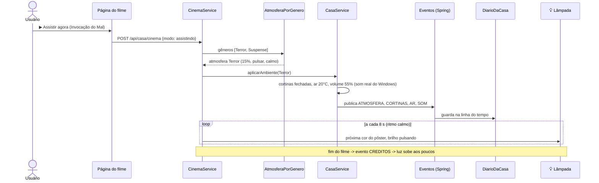

# 🏛️ Arquitetura do LetterRoyale — a casa inteligente dos seus filmes

> **Ideia central:** o filme é o centro da casa. Quando você aperta **▶ Assistir agora**, a sala inteira entra no clima do filme: a lâmpada pega as cores do pôster, as cortinas fecham, o ar-condicionado ajusta e o som muda, **cada aparelho do seu jeito**, conforme o gênero do filme.

Leia também: [FLUXO.md](FLUXO.md) (telas e rotas) e [LAMPADA.md](LAMPADA.md) (lâmpada Tuya/Tramontina).

---

## 1. Visão geral

```mermaid
flowchart LR
    subgraph Navegador["Navegador / WebView (HTML + CSS + JS)"]
        UI[Telas: Início, Filme, Smart Home]
        SALA[Sala ao vivo<br>gêmeo digital]
        VOZ[🎙️ Comando de voz<br>Web Speech API]
    end
    subgraph Back["Back-end Java 25 + Spring Boot 3.5"]
        CTRL[Controllers REST<br>/api/...]
        CIN[CinemaService<br>Modo Cinema]
        ATM[AtmosferaPorGenero<br>+ EfeitoLuz]
        CASA[CasaService<br>aparelhos]
        EV((Eventos da casa<br>EventoCasa))
        DIARIO[DiarioDaCasa<br>@EventListener]
        PAL[PaletaService<br>cores do pôster]
    end
    DB[(MySQL)]
    TMDB[API do TMDB]
    TUYA[Nuvem Tuya]
    LAMP[💡 Lâmpada Tramontina]
    WIN[🔊 Som do Windows<br>+ Bluetooth]

    UI --> CTRL
    VOZ --> CTRL
    SALA -->|GET /api/casa/eventos| CTRL
    CTRL --> CIN & CASA
    CIN --> ATM
    CIN --> PAL --> TMDB
    CIN --> TMDB
    CIN & CASA -->|publicam| EV --> DIARIO
    CIN & CASA --> DB
    CASA --> TUYA --> LAMP
    CIN --> TUYA
    CASA --> WIN
```

| Camada | O que faz | Onde está |
|---|---|---|
| **Front** | Telas, Sala ao vivo, comando de voz | `frontend/js/paginas/` (`casa.js`, `sala.js`) |
| **Controllers** | Recebem as requisições HTTP e checam o login (JWT) | `backend/.../controller/` |
| **Serviços** | Regras do sistema: Modo Cinema, cenas, aparelhos | `backend/.../casa/` |
| **Domínio puro** | Regras sem Spring e sem banco, **100% testáveis** | `casa/atmosfera/`, `casa/eventos/` |
| **Integrações** | TMDB (filmes), Tuya (lâmpada), Windows (som/Bluetooth) | `tmdb/`, `casa/TuyaService`, `casa/SomService` |
| **Banco** | MySQL | `database/schema.sql` |

---

## 2. Atmosfera por gênero 🌌 (novo)

O **pôster** decide as **cores**. A **atmosfera** decide **o resto da sala**.
Os gêneros do filme vêm do TMDB e a primeira regra que bate ganha (a lista está em ordem de prioridade):

| Atmosfera | Gêneros (TMDB) | Luz | Efeito | Ritmo | Cortinas | Ar | Volume |
|---|---|---|---|---|---|---|---|
| **Terror** | Terror | 15% | pulsando (coração acelerado) | calmo | fechadas | 20°C | 55% |
| **Suspense** | Suspense, Mistério, Crime | 20% | respirando | calmo | fechadas | 21°C | 50% |
| **Ação** | Ação, Guerra, Faroeste | 45% | um clarão de explosão | festa | fechadas | 20°C | 60% |
| **Ficção e aventura** | Ficção científica, Fantasia, Aventura | 35% | respirando | normal | fechadas | 21°C | 55% |
| **Romance** | Romance | 25% | respirando | calmo | fechadas | 23°C | 40% |
| **Música** | Música | 50% | constante | festa | meio | 22°C | 60% |
| **Animação e família** | Animação, Família | 55% | constante | normal | meio | 23°C | 45% |
| **Comédia** | Comédia | 60% | constante | normal | meio | 23°C | 45% |
| **Documentário** | Documentário | 50% | constante | calmo | meio | 22°C | 40% |
| **Drama** | Drama, História | 30% | constante | calmo | fechadas | 22°C | 45% |
| **Cinema clássico** | qualquer outro | 30% | constante | normal | fechadas | 22°C | 50% |

Exemplos: *Invocação do Mal* → Terror • *Matrix* → Ação • *Interestelar* → Ficção e aventura • *Shrek* → Animação e família.

**Efeitos de luz** (`EfeitoLuz.java`): a cada troca de cor, o brilho enviado para a lâmpada muda:

| Efeito | Brilho a cada troca (brilho base = 100%) |
|---|---|
| Constante | 100% sempre |
| Respirar | 100% → 85% → 70% → 85% → ... |
| Pulsar | 100% → 40% → 100% → 40% → ... |
| Relâmpago | brilho base e **um clarão de 100%** logo no começo (uma piscada só) |

Nunca vai abaixo de 5% (a lâmpada apagaria).

**Para criar uma atmosfera nova** é só somar **uma linha** em `AtmosferaPorGenero.ATMOSFERAS`. Nenhum outro arquivo muda. O teste `todasValidas` confere sozinho se os valores são aceitos pelos aparelhos.

---

## 3. Arquitetura orientada a eventos 📡 (novo)

Quem faz uma ação **publica um evento**. Quem quer saber **escuta**. Um não conhece o outro (padrão *Observer*, com os eventos do próprio Spring, sem instalar nada).



| Evento | Quando acontece |
|---|---|
| 🎬 `SESSAO_INICIADA` | Modo Cinema ligado / filme começou |
| 🌌 `ATMOSFERA` | Atmosfera do filme aplicada |
| 🎞️ `CREDITOS` | Filme terminou |
| ⏹️ `CINEMA_DESLIGADO` | Modo Cinema desligado |
| ✨ `CENA` | Cena ativada (Maratona, Pausa...) |
| 💡 `LUZ` · 🪟 `CORTINAS` · ❄️ `AR` · 🔊 `SOM` | Aparelho mudou (pela tela, pela voz ou pela atmosfera) |

**Por que isso importa:** amanhã, um ouvinte novo (mandar notificação no celular, gerar estatística, ligar uma pipoqueira inteligente) é **uma classe nova com `@EventListener`**. O CinemaService não muda.

O `DiarioDaCasa` guarda os **últimos 30 eventos de cada usuário** em memória (fila circular: o mais antigo sai). Assim a memória não cresce sem parar.

---

## 4. Sala ao vivo (gêmeo digital) 🛰️ (novo)

Na tela **Smart Home** existe um desenho da sala que mostra **ao vivo** o estado de todos os aparelhos:

- 💡 a lâmpada brilha **na cor que a lâmpada real está** (a mesma cor do pôster), com a força do brilho;
- 🪟 as cortinas abrem e fecham;
- ❄️ o ar mostra a temperatura e "sopra" quando está ligado;
- 📺 a TV mostra a imagem do filme que está passando e a barra de volume;
- ao lado: a **atmosfera** atual e a **linha do tempo** da casa (`GET /api/casa/eventos`).

Um *gêmeo digital* é uma cópia virtual de algo físico. Hoje a lâmpada e o som são **reais** e as cortinas e o ar são **simulados**. Quando um aparelho simulado virar real, o desenho continua igual.

---

## 5. Comando de voz 🎙️ (novo)

Botão **🎙️ Voz** na Sala ao vivo. Usa o reconhecimento de fala do próprio Chrome/Edge (Web Speech API), em português. Não instala nada. Precisa de internet e funciona em `localhost`.

| Diga | O que acontece |
|---|---|
| "fechar cortinas" / "abrir cortinas" / "cortina pela metade" | Cortinas |
| "luz 40 por cento" / "apagar a luz" / "acender a luz" | Lâmpada |
| "luz azul" / "luz vermelha" / "lâmpada verde" / "cor rosa" | Cor da lâmpada (sai do Modo Cinema) |
| "ar 20 graus" / "desligar o ar" | Ar-condicionado |
| "volume 30" / "colocar no mudo" | TV e Som (volume real do Windows) |
| "modo cinema" / "maratona" / "intervalo" / "créditos" | Cenas |
| "ritmo calmo" / "ritmo festa" | Ritmo das cores |
| "encerrar filme" / "próximo da fila" | Modo Cinema |
| "**LetterRoyale, modo terror**" / "clima de romance" / "modo ação" | Muda a atmosfera na hora ("LetterRoyale" é a palavra de chamada) |
| "intervalo" / "continuar" / "voltar ao filme" | Intervalo de verdade |

A parte que **entende a frase** (`ComandoVoz.interpretar`) é separada do microfone. Por isso deu pra testar com 32 frases sem falar nada.

---

## 6. Casa de verdade: cortina, ar, celular, votação e gestos 🔌 (novo)

### Cortina e ar-condicionado reais
Hoje a lâmpada e o som são reais. **Cortina e ar também viram reais**: em **Gerenciar → Aparelhos conectados** o site lista o que está na conta Smart Life, **reconhece a cortina e o ar pelo tipo** (categorias Tuya `cl`, `kt`, `infrared_ac`...) e conecta sozinho. Sem aparelho, eles continuam simulados (o selo mostra **Simulado** ou **Conectado**). Há uma "configuração manual (avançado)" escondida para casos raros.

| Aparelho | Como conecta | O que o site manda (`ComandosTuya.java`) |
|---|---|---|
| Cortina com motor Wi-Fi (Smart Life) | ID do aparelho | `control: open/close`, `percent_control: 50` (meio) |
| Ar-condicionado com Wi-Fi (Smart Life) | ID do aparelho | `switch: true/false`, `temp_set: 16..30` (respeita a escala do aparelho) |
| Ar comum, sem Wi-Fi | `ir:ID_DO_HUB:ID_DO_CONTROLE` (controle universal infravermelho Tuya) | `power`, `mode: gelar`, `temp`, `wind: automático` |

Cenas, atmosferas, voz, gestos e o celular passam pelo mesmo caminho, então tudo mexe no aparelho real assim que ele é cadastrado.

### Intervalo de verdade
Antes, a cena "Pausa" **desligava** o Modo Cinema. Agora tem **⏸ Intervalo**: as cores param, a luz sobe para 60% e o **relógio do filme congela**. Ao voltar, o fim do filme é empurrado pelo tempo parado, e os créditos chegam na hora certa.

### 📱 Celular como controle (QR code)
**Sala ao vivo → 📱 Celular** mostra um QR code com o endereço do computador **no Wi-Fi** (ex.: `http://192.168.0.15:8080`, achado por `RedeLocal.java`, que ignora VPN e placas virtuais) e um **token que vale 12 horas**. O celular vira um controle com intervalo, atmosferas, luz, volume, ar, cortinas, cenas e voz. O QR code é gerado **no próprio navegador**, sem internet (`js/lib/qrcode.js`, biblioteca MIT de Kazuhiko Arase).

### Votação
**Menu da esquerda → Votação** (página própria): busque ou escolha quantos títulos quiser, no mínimo 2 (filmes, séries e documentários; o que ainda não estreou só mostra um aviso). Dá pra **sair sem escolher** (cancela a votação). Os amigos escaneiam o QR e votam **sem precisar de conta** (1 voto por celular, dá pra trocar). Em **Encerrar e assistir o vencedor**, o filme começa com a atmosfera dele. Empate = ganha o primeiro da lista. Encerrar sem nenhum voto só mostra um aviso.

### ✋ Gestos pela webcam (beta)
**Sala ao vivo → ✋ Gestos**: **mão aberta** segurada ~1 s = intervalo; **👍 joinha** = volta pro filme. Usa o **MediaPipe Gesture Recognizer** (IA do Google que roda **dentro do navegador**: a imagem não sai do computador). Para evitar disparo sem querer, o gesto precisa ficar parado ~1 s e há 3 s de espera entre comandos.

### 🎬 Semelhantes e "Nos cinemas"
- **Semelhantes** não usa mais o "similar" do TMDB, que só compara palavras-chave e trazia filmes nada a ver. A ordem agora é: **a saga** (coleção do TMDB; se um filme novo ainda não foi ligado à coleção, ela é procurada pelo nome antes dos dois-pontos, ex.: "Jogos Vorazes", em `TituloSaga.java`) → **recomendações** → filmes populares **dos mesmos gêneros**.
- **Onde assistir**: se o filme não está em nenhum streaming por assinatura, aparece **"Em cartaz nos cinemas"** (estreou há até 75 dias) ou **"Estreia nos cinemas em..."**, com botão **Ver sessões** (`NosCinemas.java`).

---

## 7. Rotas novas

| Método | Rota | Para quê |
|---|---|---|
| GET | `/api/casa/eventos?limite=15` | Linha do tempo da casa (mais novo primeiro) |
| GET | `/api/casa/atmosferas` | Todas as atmosferas |
| GET | `/api/casa/cinema` | (já existia) agora também devolve `atmosfera` e `pausado` |
| POST | `/api/casa/cinema/pausar` · `/api/casa/cinema/retomar` | Intervalo de verdade |
| POST | `/api/casa/atmosfera` `{chave}` | "Modo terror" na hora, com ou sem filme |
| PUT | `/api/casa/dispositivos/{id}/aparelho` `{device_id}` | Cadastra cortina/ar real (vazio = simulado) |
| POST | `/api/casa/dispositivos/{id}/testar` | Reenvia o estado pro aparelho |
| GET | `/api/casa/controle/convite` | Endereço na rede + token de 12 h (QR do celular) |
| POST/GET | `/api/casa/votacao` · POST `/api/casa/votacao/encerrar` | Anfitrião abre, acompanha e encerra a votação |
| GET | `/api/votacao/{codigo}` · POST `/api/votacao/{codigo}/votar` | **Aberta**: celular dos amigos (sem login) |
| DELETE | `/api/casa/votacao` | "Sair sem escolher": cancela a votação |
| GET | `/api/filmes/foco?url=` | **Verificador de banner**: quanto tem de pele em cada faixa da imagem (só imagens do TMDB) |
| GET/POST | `/api/conversas` · `/api/conversas/{id}/respostas` · POST `/{id}/curtir` · DELETE `/{id}` | **Conversas** estilo Twitter na tela Reviews ("me indiquem um filme"), respostas com filme marcado e notificação pro dono |
| GET/POST | `/api/reviews/{id}/respostas` | Responder uma **review** (mesmo fio das Conversas, com filme indicado e notificação pro autor) |

Tabelas novas só das Conversas e respostas (`conversas`, `conversa_respostas`, `conversa_curtidas`, `review_respostas`), que o servidor cria sozinho ao subir. A atmosfera é calculada pelos gêneros (e recalculada se o servidor reiniciar no meio do filme).

---

### Verificador de banner (o banner não corta a cabeça de ninguém)
O banner do site é bem mais largo que a imagem do TMDB (16:9), então sempre sobra imagem em cima ou embaixo. A regra é a de um editor de cinema:
1. `FocoDoBanner` (Java puro, com JUnit) divide a imagem em 40 faixas e mede quanto tem de **pele** em cada uma, pela proporção entre as cores (pega pele clara e escura; fogo, explosão e céu ficam de fora). A esquerda quase não conta: lá ficam o título e o pôster.
2. Acha o **topo das pessoas** (a primeira faixa com bastante pele). Mirar no topo nunca corta a cabeça e não "foca no peito".
3. O banner começa um pouco **acima** desse topo (folga pra testa e cabelo). Sem gente na imagem: mostra a parte de cima (20%).
4. O navegador aplica a posição **antes** de mostrar a imagem (o usuário não vê nada se mexer) e guarda o resultado: na próxima visita é instantâneo.

## 8. Testes automatizados ✅

Dois cliques no **`testar.cmd`** (na raiz do projeto), ou no terminal: `.\testar.cmd`.
Ele usa o **JDK 27 da pasta `oracleJdk-27`** (o projeto pede Java 25+; um Java mais velho dá "release version 25 not supported").

> **Para rodar o site com o código novo use o `rodar.cmd`.** Rodar o `.jar` antigo da pasta `target` sobe a versão de antes das mudanças.

| Arquivo | O que garante | Testes |
|---|---|---|
| `AtmosferaPorGeneroTest` | Terror ganha de tudo; Matrix = Ação; Shrek = Família; séries funcionam; sem gênero não quebra; todos os valores são aceitos pelos aparelhos | 9 |
| `EfeitoLuzTest` | Pulsar, respirar e relâmpago dão o brilho certo; nunca abaixo de 5% nem acima de 100% | 7 |
| `HistoricoCasaTest` | Ordem da linha do tempo; limite de memória; cada usuário vê só a sua casa; aguenta 1000 eventos ao mesmo tempo | 6 |
| `PaletaServiceTest` | Cores do pôster **sem internet**: vermelho+azul, preto e branco vira luz quente, preto é ignorado, máximo 5 cores | 6 |
| `RitmoCinemaTest` | Calmo 8 s, normal 4 s, festa 2 s (limite da nuvem Tuya) | 1 |
| `ComandosTuyaTest` | Cortina abre/fecha/meio; ar Wi-Fi com escala certa; ar por infravermelho; IDs errados recusados | 8 |
| `VotacaoTest` | Mais votado ganha; 1 voto por celular; empate; votação encerrada não aceita voto; 2 a 6 filmes | 6 |
| `RedeLocalTest` | Escolhe o IP do Wi-Fi (192.168...) e ignora VPN/IP público | 3 |
| `NosCinemasTest` | Em breve / em cartaz (até 75 dias) / antigo; datas do TMDB; link de sessões | 5 |
| `TituloSagaTest` | "Jogos Vorazes: Amanhecer..." vira "Jogos Vorazes"; confere se a coleção achada é da mesma saga | 3 |
| **Total** | | **54 ✔** |

Além disso, no front: **39 frases** do comando de voz conferidas (`ComandoVoz.interpretar`), **6 casos** da lógica dos gestos (segurar ~1 s, esperar 3 s) e o **QR code lido por um leitor de verdade** (OpenCV).

---

## 9. Decisões de arquitetura (por quê?)

| Decisão | Por quê |
|---|---|
| **Java + Spring Boot** no back | Exigência do projeto. O Spring dá injeção de dependência, agendador (`@Scheduled`) e eventos prontos |
| **Lâmpada pela nuvem Tuya** e não pelo app T Smart | A Tramontina é *white label* da Tuya. A API oficial da Tuya deixa o **site** controlar a lâmpada |
| **Regras puras separadas do Spring** (`atmosfera/`, `eventos/`) | Dá pra testar sem banco, sem internet e sem lâmpada, em milissegundos |
| **Eventos em vez de chamadas diretas** | Aparelhos e ouvintes novos entram sem mexer no Modo Cinema |
| **Atmosfera calculada, não salva** | Zero mudança no banco. O TMDB já guarda os gêneros, e a resposta fica em cache por 5 min |
| **Aparelhos simulados com a mesma interface dos reais** | Cortinas e ar funcionam na demo hoje e viram reais depois sem mudar a tela |
| **Rodar em localhost** | Sem custo de hospedagem. A lâmpada e o som são do computador onde o servidor roda |
| **QR com o IP do Wi-Fi + token de 12 h** | O celular acessa o PC pela rede de casa. Se o QR vazar, o acesso vence sozinho |
| **Votação em memória e sem login** | Uma noite de filme não precisa ir pro banco, e amigo não precisa criar conta |
| **IA dos gestos no navegador** | Privacidade (a câmera não sai do PC) e zero instalação no servidor |


**Performance e gestos (novo):**

- **Chamadas ao TMDB em paralelo (performance):** `TmdbService.emParalelo(...)` usa *virtual threads* (threads virtuais) do Java. A busca por texto pedia 5 páginas + até 21 detalhes **uma atrás da outra** (~4 s para "batman"); agora saem juntas e levam o tempo da mais lenta. O mesmo vale para os "Semelhantes" (coleção, filmes do ator, gênero) e para a busca por pessoa. `TmdbService.resultado(...)` devolve JSON vazio se o TMDB falhar, então uma parte fora do ar não derruba a página.
- **Gestos com qualquer mão:** além da IA do MediaPipe (agora olhando até 2 mãos), há um "plano B" geométrico (`GestosCamera.pelaGeometria`) que reconhece joinha e mão aberta pelas distâncias dos 21 pontos da mão até o pulso, sem depender de ser mão direita ou esquerda.
- **HTTPS na rede de casa (microfone do celular):** o Chrome só libera microfone em site seguro. No boot, `CertificadoLocal` usa o `keytool` do Java pra criar uma CA (autoridade certificadora) só deste PC (uma vez) e um certificado do servidor com os IPs atuais (refeito quando a rede muda). `HttpsLocal` abre a porta **8443** com ele; o PC continua em `http://localhost:8080`. O QR do controle aponta pra `https://IP:8443`, e o celular instala `/certificado/letterroyale-ca.crt` uma vez. A votação dos amigos continua em http (ninguém precisa instalar nada). Chaves ficam em `segredos/https/` (fora do Git).
- **Voz: um comando por vez:** entendeu o comando, o microfone desliga sozinho (PC e celular).

---

## 10. Roadmap 2050 🚀

O LetterRoyale foi desenhado para crescer **sem reescrever**: cada item abaixo entra como **uma atmosfera nova, um ouvinte de evento novo ou um aparelho novo**.

| Horizonte | Ideia | Como entra na arquitetura |
|---|---|---|
| ✅ **Feito** | Cortina e ar **reais** (Tuya Wi-Fi ou infravermelho), celular-controle por QR, votação, gestos | Ver seção 6 |
| **Próximo** | Notificação "seu filme começa em 10 min" no celular | Ouvinte novo de `SESSAO_INICIADA` |
| **Próximo** | Padrão **Matter** (aparelhos de qualquer marca conversando) | Um adaptador novo no lugar do `TuyaService` |
| **Médio** | **Cena por cena**: a luz muda junto com a cena do filme, não só pelo pôster | `EfeitoLuz` recebe a cor do momento do vídeo |
| **Médio** | **Perfis da casa**: cada pessoa tem sua atmosfera preferida | Atmosfera vira personalizável por usuário |
| **Médio** | Recomendação pelo **humor e horário** ("noite de chuva → suspense") | Ouvinte de eventos + histórico de assistidos |
| **2050** | Sala **multissensorial**: poltrona que vibra na ação, aroma de pipoca, temperatura que cai no terror | Cada sentido = um aparelho novo que escuta os eventos |
| **2050** | **Sessão compartilhada entre casas**: amigos em cidades diferentes com a mesma luz no mesmo segundo | Eventos publicados também para fora (fila de mensagens) |
| **2050** | Casa que **aprende sozinha** o clima que você gosta para cada gênero | Ajuste automático da atmosfera pelo histórico de reviews |
