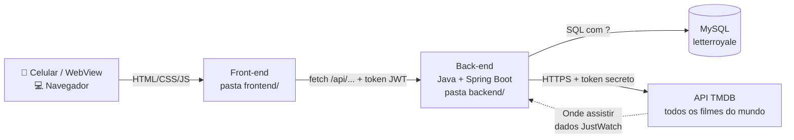
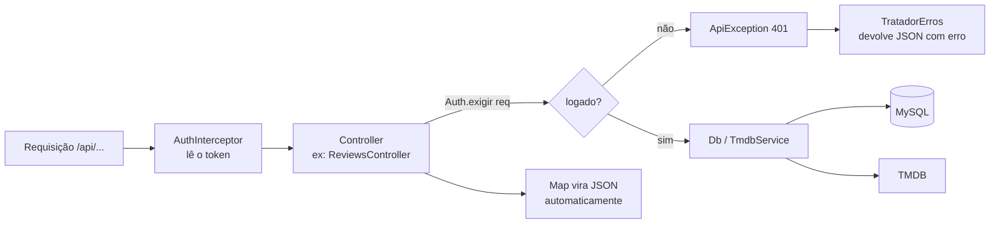
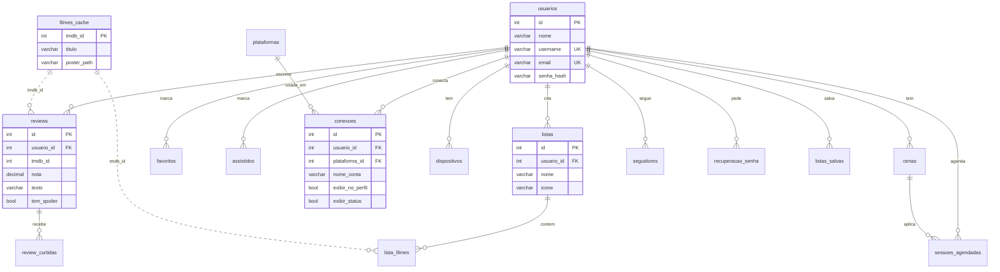
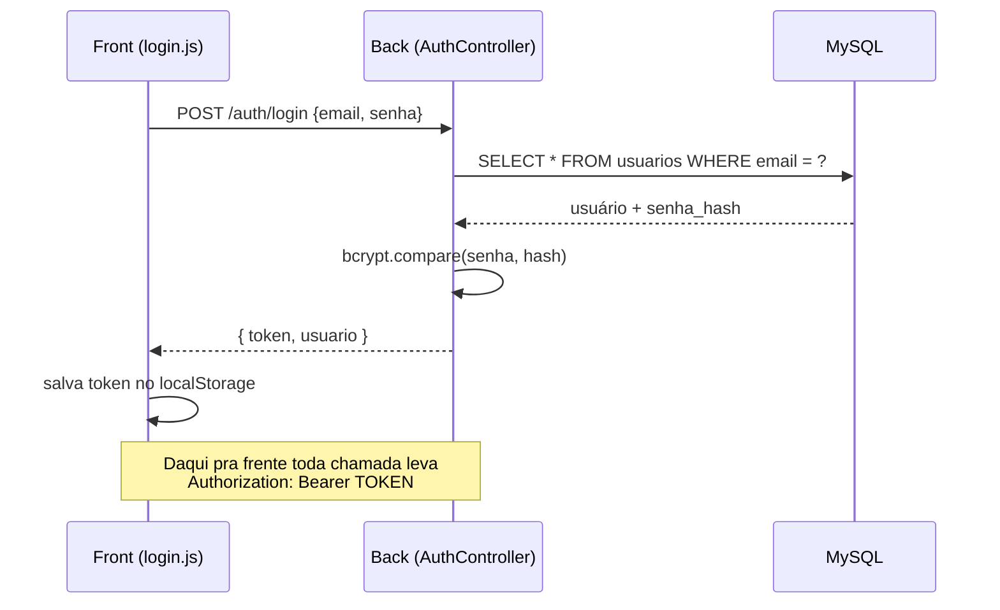
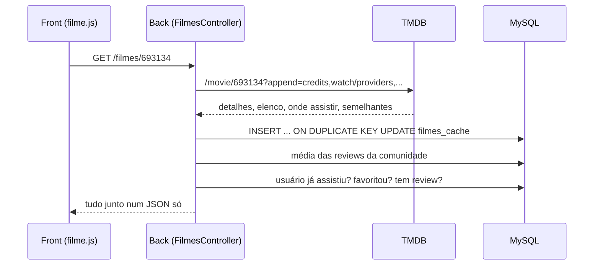
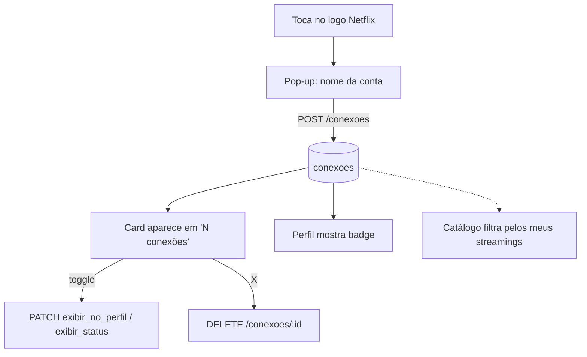

# 🎬 LetterRoyale — Fluxo do sistema (MySQL + API de filmes)

Documento para a equipe. Explica **como as peças se conversam**, **qual tela usa qual rota e qual tabela**, e **o que cada um faz**.

---

## 1. Visão geral (arquitetura)



**Regra de ouro:** o front **nunca** fala direto com o MySQL nem com o TMDB. Tudo passa pelo back-end.
- MySQL guarda o que é **do usuário** (conta, reviews, listas, favoritos, conexões, casa).
- TMDB guarda os **filmes** (≈1 milhão de títulos, pôsteres, elenco, trailers, onde assistir no Brasil).
- No MySQL o filme é só um número: `tmdb_id`. A tabela `filmes_cache` guarda título + pôster pra listar rápido.

### Por que TMDB?
| API | Filmes | Grátis | Português | Onde assistir (BR) |
|---|---|---|---|---|
| **TMDB** ✅ | ~1 milhão | Sim (uso não comercial) | Sim (`pt-BR`) | Sim |
| OMDb | muitos | 1.000 req/dia | Não | Não |

> Obrigatório pelos termos do TMDB: mostrar em algum lugar (ex: rodapé ou "Sobre") *"Este produto usa a API do TMDB, mas não é endossado nem certificado pelo TMDB"* com o logo deles.

---

## 2. Estrutura de pastas

```
letterroyale/
├── database/schema.sql            ← cria o banco, tabelas e plataformas
├── backend/                       ← projeto Java (Maven)
│   ├── pom.xml                    ← bibliotecas (dependências) do projeto
│   └── src/main/
│       ├── resources/application.properties   ← config (MySQL, TMDB, JWT) via variáveis de ambiente
│       └── java/br/com/letterroyale/
│           ├── LetterRoyaleApplication.java    ← classe main (▶ rodar)
│           ├── config/WebConfig.java           ← CORS, serve o site, liga o login
│           ├── seguranca/                      ← JwtService, AuthInterceptor, Auth, UsuarioLogado
│           ├── erro/                           ← ApiException + TratadorErros (respostas {erro: "..."})
│           ├── util/Db.java                    ← atalhos de SQL (JdbcTemplate)
│           ├── util/Json.java                  ← ler o corpo das requisições
│           ├── tmdb/TmdbService.java           ← fala com o TMDB + cache
│           └── controller/                     ← 1 classe por área do site
│               AuthController · FilmesController · AtividadeController · ReviewsController
│               ListasController · UsuariosController · ConexoesController · CasaController
└── frontend/                      ← o site (não depende da linguagem do back)
    ├── index.html
    ├── css/style.css              ← cores/fontes do Figma (variáveis)
    └── js/
        ├── api.js                 ← TODAS as chamadas ao back
        ├── ui.js                  ← cards, toast, pop-ups
        ├── app.js                 ← menu + roteador (#/inicio, #/filmes...)
        └── paginas/               ← 1 arquivo por tela do Figma
```

### Por que JdbcTemplate e não JPA/Hibernate?
Com o `JdbcTemplate` (ferramenta do Spring para rodar SQL) o SQL fica **escrito e visível** em cada controller — dá pra copiar, colar no MySQL Workbench e testar. Pra quem está aprendendo banco isso ajuda muito. Se o professor pedir JPA, dá pra migrar depois criando `@Entity` (entidade) + `Repository` (repositório) por tabela, sem mexer no front.

### Como uma requisição anda dentro do Java


---

## 3. Como rodar (passo a passo)

1. Instalar **Java 25+** (JDK — kit de desenvolvimento), **MySQL 8** e o **IntelliJ IDEA Community** (grátis, já vem com Maven).
  Para guardar credenciais localmente, copie `segredos/segredos.properties.example` para `segredos/segredos.properties` e preencha os valores. Esse arquivo não deve ser enviado ao Git.
2. Criar o banco e os dados de teste:
   ```bash
   mysql -u root -p < database/schema.sql
   mysql -u root -p < database/seed.sql
   ```
   Usuários de teste (senha **123456**): `ana@email.com`, `carlos@email.com`, `mari@email.com`.
   Já tinha um banco antigo? Rode antes `DROP DATABASE IF EXISTS letterroyale;` (apaga tudo).
3. Pegar o token do TMDB: criar conta em themoviedb.org → *Settings → API* → copiar o **API Read Access Token** (token de leitura).
4. No IntelliJ: *File → Open* → escolher a pasta `backend` (ele reconhece o `pom.xml` e baixa as bibliotecas sozinho).
5. Configurar as variáveis de ambiente (environment variables): *Run → Edit Configurations → LetterRoyaleApplication → Environment variables*:
   ```
   DB_PASSWORD=sua_senha_do_mysql;TMDB_TOKEN=eyJ...;JWT_SECRET=um-texto-grande-com-mais-de-32-caracteres
   ```
   (Se o usuário do MySQL não for `root`, adicionar `DB_USER=...`.)
6. Rodar a classe `LetterRoyaleApplication` (botão ▶).
   Pelo terminal, com Maven instalado: `cd backend && mvn spring-boot:run`
7. Abrir `http://localhost:8080` → Criar conta → pronto.

> O site (pasta `frontend/`) é servido pelo próprio Spring. Se abrir o projeto pela pasta raiz em vez de `backend/`, também funciona.

---

## 4. Banco de dados (diagrama ER — Entidade-Relacionamento)



O banco é o **schema da equipe** + colunas/tabelas que o back-end usa (marcadas com `-- [+]` no `schema.sql`).
Em `seguidores`: `usuario_id` = quem **é seguido**, `seguidor_id` = quem **segue**.

Regras importantes que o banco já garante:
- Reviews, listas, favoritos e assistidos só aceitam filmes que estão em `filmes_cache` (chave estrangeira). O back-end sempre coloca o filme no cache antes de salvar.
- **1 review por filme por usuário** (`UNIQUE usuario_id + tmdb_id`). Escrever de novo = editar.
- **1 conexão por plataforma** por usuário.
- Apagar um usuário apaga tudo dele (`ON DELETE CASCADE`).
- Senha **nunca** é salva pura: vai como `senha_hash` (bcrypt).

---

## 5. Fluxo de login (JWT)



**Cadastro** usa `@Transactional` (transação — ou grava tudo ou nada): cria o usuário **+** 5 listas padrão (Favoritos, Quero assistir, Clássicos, Terror, Sci-Fi) **+** 4 dispositivos **+** 4 cenas da Smart Home.

**Recuperar senha:** `POST /auth/esqueci-senha` gera código de 6 dígitos (vale 15 min, tabela `recuperacao_senha`) → `POST /auth/redefinir-senha`. Em modo dev o código aparece na tela; em produção precisa enviar por e-mail (ver tarefas).

---

## 6. Fluxo de um filme (TMDB + cache)



Quando o usuário **favorita / marca assistido / adiciona à lista / escreve review**, o back chama `tmdb.garantirNoCache(tmdbId)` antes de gravar. Assim Perfil, Listas e Reviews conseguem mostrar título e pôster só com SQL (`JOIN filmes_cache`), sem chamar o TMDB de novo.

O back (`TmdbService`) também guarda as respostas do TMDB **5 min em memória** para não estourar o limite de requisições.

---

## 7. Mapa: Tela do Figma → Rota da API → Tabelas

| Tela (Figma) | Rota no site | Chamadas da API | Tabelas MySQL |
|---|---|---|---|
| Boas-vindas | `#/` | `GET /filmes/em-alta` (pôsteres de fundo) | — (TMDB) |
| Login | `#/login` | `POST /auth/login` | usuarios |
| Criar conta | `#/cadastro` | `POST /auth/cadastro` | usuarios, listas, dispositivos, cenas |
| Recuperação de senha | `#/recuperar` | `POST /auth/esqueci-senha`, `POST /auth/redefinir-senha` | recuperacao_senha, usuarios |
| **Início** | `#/inicio` | `GET /filmes/em-alta`, `GET /filmes/:fav/recomendados`, `GET /atividade/continuar`, `GET /casa`, `GET /atividade/amigos` | assistidos, favoritos, dispositivos, cenas, seguidores |
| **Catálogo** | `#/filmes?genero=&ano=&classificacao=&streaming=&ordem=&pagina=` | `GET /filmes`, `GET /filmes/generos`, `GET /filmes/streamings` | — (TMDB) |
| Busca do topo | `#/filmes?q=duna` | `GET /filmes?q=` | — (TMDB) |
| **Detalhes do filme** | `#/filme/:id` | `GET /filmes/:id`, `GET /reviews/filme/:id` | filmes_cache, reviews, assistidos, favoritos |
| ↳ botão Assistido | | `POST /atividade/assistido/:id` | assistidos |
| ↳ botão Favoritar | | `POST /atividade/favorito/:id` | favoritos |
| ↳ Adicionar à lista | | `GET /listas?aba=minhas`, `POST /listas/:id/filmes` | listas, lista_filmes |
| **Escrever review** | `#/filme/:id/review` | `POST /reviews` | reviews, assistidos |
| **Avaliações** | `#/filme/:id/avaliacoes` | `GET /reviews/filme/:id`, `POST /reviews/:id/curtir` | reviews, review_curtidas |
| **Reviews** | `#/reviews?filtro=todas\|recentes\|nota_alta\|nota_baixa` | `GET /reviews`, `GET /reviews/mais-comentados`, `GET /reviews/minhas/resumo` | reviews, review_curtidas, filmes_cache |
| **Minhas listas** | `#/listas?aba=todas\|minhas\|salvas` | `GET /listas`, `POST /listas`, `DELETE /listas/:id` | listas, lista_filmes, listas_salvas |
| Minha lista — X | `#/lista/:id` | `GET /listas/:id`, `DELETE /listas/:id/filmes/:tmdbId` | lista_filmes, filmes_cache |
| **Perfil** | `#/perfil` ou `#/perfil/:username` | `GET /usuarios/:username`, `PUT /usuarios/me`, `POST /usuarios/:u/seguir` | usuarios, favoritos, listas, conexoes, seguidores |
| **Smart Home** | `#/casa` | `GET /casa`, `PATCH /casa/dispositivos/:id`, `POST /casa/cenas/:id/ativar`, `POST /casa/cenas/desativar`, `/casa/lampada/...` | dispositivos, cenas, sessoes_agendadas |
| **Conexões** (nova) | `#/conexoes` | `GET /conexoes/plataformas`, `GET /conexoes`, `POST /conexoes`, `PATCH /conexoes/:id`, `DELETE /conexoes/:id` | plataformas, conexoes |

---

## 8. Conexões (a tela que ainda não estava pronta)

- Entrou no **menu lateral** (desktop) e na **barra de baixo com scroll lateral** (celular) — é só arrastar pro lado que aparecem Conexões e Perfil.
- Netflix, Prime, HBO etc. **não têm API pública de login**. Então a conexão é o usuário informar a conta que tem. Ela é usada para:
  1. **Exibir no perfil** (badge colorido no topo do Perfil).
  2. **Exibir como status** (só 1 por vez — o back desliga as outras).
  3. **Próximo passo (tarefa):** no Catálogo, filtro "Nos meus streamings" usando `plataformas.tmdb_provider_id` → `with_watch_providers=8|119|...` do TMDB; e no Detalhes, destacar em "Onde assistir" os serviços que a pessoa tem.



---

## 9. Smart Home com lâmpada de verdade 💡

A **iluminação** controla uma lâmpada real (Tramontina / Tuya) pela nuvem da Tuya. Enquanto ela não chega, roda em **modo simulação**.
Cortinas, temperatura e TV continuam simulados (só banco).
O agendador liga a cena sozinho na hora da **Próxima sessão** ("Modo Cinema automático").

**🎬 Modo Cinema = cores do pôster.** A lâmpada troca entre as cores do pôster do filme que você está vendo no site (ou do filme que apertou **Assistir agora**). No fim do filme: marca como assistido, luz de Créditos e o site pergunta **"O que achou?"**.

👉 Passo a passo completo, configuração e tabela de erros: **[LAMPADA.md](LAMPADA.md)**

---

## 10. Celular e WebView

- Layout **responsivo** (se adapta ao tamanho): acima de 900px = barra lateral; abaixo = barra de baixo estilo app, com scroll lateral.
- Respeita o "notch" (entalhe) do iPhone (`viewport-fit=cover` + `safe-area-inset`).
- Rotas com `#/` → funcionam dentro de WebView sem configurar servidor.
- Sem `prompt()`/`alert()` nas ações principais (algumas WebViews bloqueiam) — usamos `<dialog>`.
- Para o app (WebView no Android/iOS ou Capacitor): antes de `api.js`, definir
  ```html
  <script>window.API_URL = 'https://endereco-do-servidor.com';</script>
  ```
  O back já tem `cors()` liberado. No Android, WebView precisa de `setJavaScriptEnabled(true)` e `setDomStorageEnabled(true)` (por causa do `localStorage`).

---

## 11. Divisão de tarefas sugerida

| Pessoa | Parte | O que fazer |
|---|---|---|
| 1 | **Banco** | ✅ `schema.sql` + `seed.sql` prontos. Próximo: mais filmes e reviews no seed pra apresentação ficar cheia. |
| 2 | **Back — auth** | Envio do código por e-mail (`spring-boot-starter-mail`) e "Entrar com Google" (`google-api-client`). |
| 3 | **Back — filmes/conexões** | Filtro "Nos meus streamings"; busca de pessoas (`/search/person`) pro "atores, diretores". |
| 4 | **Front — telas** | Ajustes finos com o Figma, tela de Editar perfil completa (foto), notificações (sininho). |
| 5 | **Smart Home / App** | Seguir o LAMPADA.md quando a lâmpada chegar; botão "Agendar sessão" na tela de detalhes; empacotar em WebView (Capacitor). |

### Checklist antes de entregar
- [ ] Senha do MySQL e token do TMDB **não** foram pro GitHub (ficam só nas variáveis de ambiente)
- [ ] Aviso do TMDB no rodapé
- [ ] Testar no celular (Chrome → F12 → modo dispositivo) e num Android de verdade
- [ ] Toda query usa `?` (nada de juntar texto do usuário no SQL)
