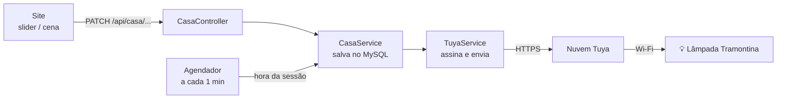

# 💡 Lâmpada inteligente — guia para quando ela chegar

O código já está pronto. Hoje ele roda em **modo simulação**: o site funciona normal e o console do servidor mostra o que *seria* enviado, por exemplo:

```
💡 [SIMULAÇÃO] lâmpada <- [{code=switch_led, value=true}, {code=work_mode, value=white}, {code=bright_value_v2, value=109}]
```

Quando a lâmpada chegar, vocês só precisam configurar **4 variáveis de ambiente**. Nenhuma linha de código muda.

---

## Como funciona



A lâmpada da Tramontina é *white label* (marca própria em cima de outra plataforma): por dentro ela é da **Tuya**, a mesma plataforma de Positivo, i2go, Elgin e outras. O nosso back fala com a **API oficial da Tuya** (a "Tuya Cloud").

| Ação no site | O que a lâmpada recebe |
|---|---|
| Slider "Iluminação" | liga + luz branca + brilho em % |
| Botão liga/desliga | `switch_led` true/false |
| Cena **Modo Cinema** | troca entre as **cores do pôster** do filme (ver abaixo) |
| Cena **Maratona** | brilho 20%, amarelada |
| Cena **Pausa** | brilho 60%, neutra |
| Cena **Créditos** | brilho sobe aos poucos até 80% (5 passos em ~10 s) |
| **Próxima sessão** | na hora marcada, o agendador ativa a cena escolhida sozinho |
| Gerenciar → Cor | luz colorida (16 milhões de cores) |

---

## 🎬 Modo Cinema — cores do pôster

A lâmpada **troca entre as cores principais do pôster** do filme (não analisa as cenas, só o pôster).
Ex.: Matrix → verdes • Duna → laranjas • Coringa → vermelho, verde e amarelo • filme preto e branco → luz quente.

**Dois jeitos de usar**

| Jeito | Como liga | O que acontece |
|---|---|---|
| **Navegando** | Smart Home → cena rápida **Modo Cinema** | A luz acompanha o filme que você está vendo no site. Ficou 2 s na página de Matrix → verdes. Abriu Duna → laranjas. |
| **Assistindo** | Página do filme → **▶ Assistir agora** | Trava nas cores daquele filme pela duração dele (ex.: 2h46). Navegar por outros filmes não muda a luz. |

**No fim do filme** (pelo relógio, ou pelo botão **Encerrar filme agora**, feito para a apresentação):
1. o filme é marcado como **assistido**;
2. a luz vai para a cena **Créditos** (sobe aos poucos);
3. o site, em qualquer tela, pergunta **"O que achou?"** → botão **Avaliar agora** abre a review.

**Controles**
- **Brilho:** o slider de Iluminação continua funcionando. As cores seguem trocando, só ficam mais fortes ou mais fracas (começa em 30%).
- **Ritmo:** Calmo (troca a cada 8 s) • **Normal (4 s, padrão)** • Festa (2 s). Menos de 2 s não dá, por causa do limite da nuvem Tuya.
- **Para quando:** Desativar, outra cena, ou desligar a lâmpada no site.
- **Sem lâmpada:** o ícone do card Modo Cinema muda de cor na tela, igual à lâmpada faria (ótimo pra apresentar).

**Como as cores são escolhidas** (`PaletaService.java`)
1. baixa o pôster pequeno do TMDB;
2. ignora preto/escuro (lâmpada "preta" = apagada) e cinza/branco (viraria só luz branca);
3. agrupa os pixels por cor e pega as que mais aparecem, bem diferentes entre si (máx. 5);
4. deixa as cores mais vivas;
5. salva em `filmes_cache.paleta` (só calcula 1 vez por filme).

**Rotas**

| Método | Rota | Para quê |
|---|---|---|
| GET | `/api/filmes/{id}/paleta` | cores do pôster |
| GET | `/api/casa/cinema` | ligado? filme, cores, cor atual, terminou? |
| POST | `/api/casa/cinema` `{tmdb_id?, modo, ritmo}` | liga (navegando/assistindo) |
| POST | `/api/casa/cinema/foco` `{tmdb_id}` | "estou vendo este filme" (modo navegando) |
| PATCH | `/api/casa/cinema` `{ritmo}` | muda o ritmo |
| POST | `/api/casa/cinema/terminar` | encerrar filme agora |
| DELETE | `/api/casa/cinema` | desliga / limpa o aviso de fim |

O estado fica na tabela `cinema_ativo`. Se o servidor reiniciar no meio do filme, continua de onde parou.

---

As cenas ficam na tabela `cenas`. Dá para mudar brilho (`luz`), temperatura da luz (`luz_temperatura`: 0 = amarelada, 100 = branca) e cor (`luz_cor`, ex.: `#ff3300`) direto no MySQL.

---

## Passo 1 — Testar se a lâmpada aceita o app Smart Life ⚠️ (o mais importante)

A Tuya só deixa a gente controlar pela API as lâmpadas pareadas nos apps **dela** (Smart Life ou Tuya Smart). Pelo app da Tramontina (T smart) não funciona.

1. Instale o app **Smart Life** no celular, crie uma conta e escolha o país **Brasil**.
2. Coloque a lâmpada no soquete e ligue o interruptor. Ela deve piscar rápido (modo de pareamento).
   - Se não piscar: desligue e ligue o interruptor 3 vezes seguidas.
3. No Smart Life: **+ → Adicionar dispositivo** (deixe Bluetooth e Wi-Fi 2,4 GHz ligados no celular).
4. ✅ **Se a lâmpada aparecer e acender pelo app → sigam para o Passo 2.**
5. ❌ Se não aparecer de jeito nenhum, a lâmpada não serve para a API. Plano B: trocar por uma lâmpada que funcione no Smart Life (procurar "compatível com Tuya / Smart Life" na descrição).

---

## Passo 2 — Criar o projeto na Tuya (grátis)

> A Tuya muda os nomes dos menus de vez em quando. Se algo estiver diferente, procurem o equivalente.

1. Entrem em **platform.tuya.com** e criem uma conta de desenvolvedor (developer).
2. Menu **Cloud → Development → Create Cloud Project**:
   - *Project name* (nome do projeto): LetterRoyale
   - *Industry* (área): Smart Home
   - *Development method* (tipo de desenvolvimento): Smart Home
   - *Data center* (servidor): **Western America** (é o usado pelas contas do Brasil)
3. Na tela de serviços (*API services*), deixem marcados os que já vêm: **IoT Core** e **Authorization Token Management**.
4. Na aba **Overview** (visão geral) copiem:
   - **Access ID / Client ID** → vai virar `TUYA_CLIENT_ID`
   - **Access Secret / Client Secret** → vai virar `TUYA_SECRET` (é uma senha: não mandem no grupo nem subam pro GitHub)

## Passo 3 — Vincular a conta do Smart Life ao projeto

1. No projeto, aba **Devices → Link App Account** (vincular conta do app) → **Add App Account**.
2. Aparece um QR Code. No app Smart Life: aba **Eu / Me** → ícone de escanear no topo → escaneiem o QR.
3. Confirmem no celular. A lâmpada aparece na lista da aba **Devices** com um **Device ID** (identificador do aparelho) → vai virar `TUYA_DEVICE_ID`.

## Passo 4 — Configurar o back-end

Nas variáveis de ambiente (environment variables), junto com as do MySQL e do TMDB:

```
TUYA_CLIENT_ID=o_access_id
TUYA_SECRET=o_access_secret
TUYA_DEVICE_ID=o_device_id_da_lampada
TUYA_URL=https://openapi.tuyaus.com
```

| Data center escolhido | TUYA_URL |
|---|---|
| Western America (padrão p/ Brasil) | `https://openapi.tuyaus.com` |
| Eastern America | `https://openapi-ueaz.tuyaus.com` |
| Central Europe | `https://openapi.tuyaeu.com` |
| India | `https://openapi.tuyain.com` |

**VS Code:** criem o arquivo `.vscode/launch.json` (o VS Code gera um ao clicar em *Run and Debug → create a launch.json*) e coloquem as variáveis em `"env": { "TUYA_CLIENT_ID": "...", ... }`.
**IntelliJ:** *Run → Edit Configurations → Environment variables*.

Ao reiniciar o servidor, o console deve mostrar:
```
💡 Tuya configurada (lâmpada REAL)
```

## Passo 5 — Testar pelo site

1. Smart Home → **Gerenciar**. Deve aparecer "Conectado à nuvem Tuya".
2. **Testar (piscar)** → a lâmpada acende forte e volta para 30%.
3. Mexam no slider de Iluminação e ativem o **Modo Cinema**. 🎬
4. Se tiverem mais de uma lâmpada: **Ver aparelhos da minha conta Smart Life** → cliquem na lâmpada → **Salvar** (fica salvo por usuário em `dispositivos.tuya_device_id`).

---

## Deu erro? Tabela de problemas

| Mensagem / sintoma | Causa provável | Solução |
|---|---|---|
| Console diz "MODO SIMULAÇÃO" | Variáveis não chegaram no Java | Conferir nomes e reiniciar o servidor |
| `sign invalid` (código 1004) | Client ID ou Secret copiados errado (espaço sobrando) | Copiar de novo da aba Overview |
| `permission deny` (código 1106) | Lâmpada não vinculada **ou** data center errado | Refazer o Passo 3 / conferir `TUYA_URL` |
| "No permissions… not authorized to call this API" | Serviço IoT Core não assinado ou período grátis venceu | No projeto: *Service API* → renovar o *IoT Core* (trial) |
| Lista de aparelhos vazia | Conta Smart Life de outra região | Conta do app e projeto precisam ser do mesmo data center |
| Comando aceito mas a luz não muda | Lâmpada offline (sem Wi-Fi) | Ver no app Smart Life se está online |
| Aviso "Salvo, mas a lâmpada não respondeu" | Qualquer falha acima | O site continua funcionando; a mensagem diz o motivo |

> O plano grátis da Tuya para desenvolvedores (*trial*) precisa ser renovado de tempos em tempos na plataforma. Para projeto de faculdade, é suficiente.

---

## Arquivos envolvidos

| Arquivo | O que faz |
|---|---|
| `backend/.../casa/TuyaService.java` | Assinatura HMAC-SHA256, token, envio de comandos, descobre os comandos da lâmpada |
| `backend/.../casa/PaletaService.java` | Tira as cores do pôster |
| `backend/.../casa/CinemaService.java` | Modo Cinema: troca as cores a cada X s, acompanha a navegação, fim do filme |
| `backend/.../casa/CasaService.java` | Regras: dispositivo → lâmpada, cenas, efeito gradual, agendador da "Próxima sessão" |
| `backend/.../controller/CasaController.java` | Rotas `/api/casa/...` + `/api/casa/lampada/...` |
| `frontend/js/paginas/casa.js` | Tela Smart Home + painel "Gerenciar" |
| `database/migracao_lampada.sql` | Só para quem já tinha criado o banco antes desta versão |

### Rotas novas
| Método | Rota | Para quê |
|---|---|---|
| GET | `/api/casa/lampada` | modo (real/simulação), device_id, estado atual |
| GET | `/api/casa/lampada/dispositivos` | aparelhos da conta Smart Life vinculada |
| PUT | `/api/casa/lampada` `{device_id}` | escolher a lâmpada do usuário |
| POST | `/api/casa/lampada/testar` | piscar |
| POST | `/api/casa/lampada/cor` `{hex, brilho}` | luz colorida |
